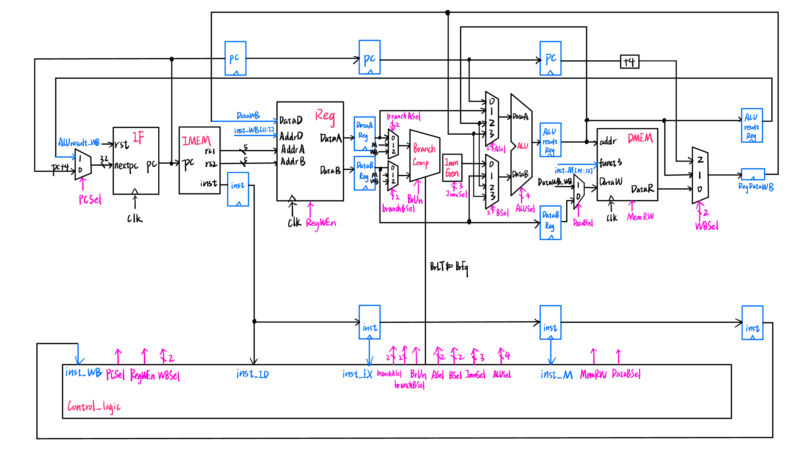

# 五级流水 RV32I 处理器

**焦佳怡 · 集成电路综合设计课程项目 · 2025**

使用 Verilog 描述 IF、ID、EX、MEM、WB 五级流水数据通路，包含 ALU、立即数生成、分支比较、数据转发与跳转清空控制。本仓库整理课程项目成果，供架构阅读、代码审阅和模块实验使用。

> **版本状态：从汇报 PPT 截图恢复的代码档案。** 原工程及原测试输入已遗失。本次恢复 17 个模块，其中 16 个独立模块可编译；顶层缺少 `WBReg_ID_Hazard`，并存在 `IMEM` 端口连接不一致。当前不能运行完整 CPU，也不宣称通过完整 RV32I 验证。



## 项目内容

- 五级流水数据通路与四组流水寄存器。
- R/I/S/B/U/J 格式相关的译码和立即数生成。
- 算术、逻辑、移位以及有符号／无符号比较。
- 从 MEM、WB 向 EX 的操作数转发，分支比较转发，以及 WB 向存储数据的转发。
- 分支成立、JAL、JALR 时清空 IF/ID 与 ID/EX 中的年轻指令。
- 指令存储器、数据存储器和寄存器文件的课程仿真模型。

具体行为及限制见 [架构说明](docs/architecture.md) 和 [已知问题](docs/known-issues.md)。

## 贡献与来源

**焦佳怡是本项目主要贡献者及本仓库维护者，承担了项目绝大部分工作。** 该贡献描述由焦佳怡本人提供。原课程汇报为小组成果，署名成员还包括陈思元、高嘉培；现有材料未提供逐模块分工，因此不将所有模块标注为单人独立原创。

2026 年的截图转录、格式整理、文档及新增验证由 Codex 辅助完成，区别于 2025 年课程开发。[署名说明](AUTHORS.md) · [恢复来源与逐模块索引](docs/provenance.md)

## 运行模块检查

依赖：Python 3.9 或更新版本、Icarus Verilog（`iverilog`、`vvp`）、Make。

```sh
# macOS
brew install icarus-verilog
# Ubuntu / Debian
sudo apt-get install iverilog python3 make

# 克隆后执行
git clone https://github.com/lllolaa330/rv32i-pipeline.git
cd rv32i-pipeline
make check
```

也可以分别执行：

```sh
python3 scripts/verify_sources.py
python3 scripts/benchmark_summary.py
python3 -m unittest discover -s tests -v
```

**检查结果：15 项，11 项通过，4 项预期失败。** 预期失败分别记录顶层缺失依赖、`x0` 错误转发、字节读取偏移、字节写入覆盖。这些是仍然存在的问题；CI 通过只表示模块检查与已知缺陷记录符合预期，不表示完整处理器正确。

测试脚本为每次仿真创建临时目录，因为原 `Reg`、`DMEM` 会覆盖输入文本文件。测试输入由脚本生成，与原课程 `test1`—`test10` 无关。[验证范围及结果](docs/validation.md)

## 仓库结构

```text
rtl/                    17 个按模块整理的 Verilog 文件
tests/test_modules.py   新增模块验证与已知问题复现
scripts/                来源完整性检查、历史性能表重新计算
docs/architecture.md    数据通路及模块说明
docs/known-issues.md    缺失材料、已验证缺陷与静态审阅发现
docs/provenance.md      代码与 PPT 页码、截图的对应关系
docs/benchmarks.md      历史性能数据及统计口径
docs/validation.md      当前验证范围
docs/recovery-report.md 本次整理的详细记录
docs/source-images/     55 张原始代码截图及 SHA-256 清单
docs/assets/            原项目数据通路图
```

## 历史结果

原汇报展示了 10 组测试，并明确将结果错误的 `test7` 排除在性能分析之外。剩余 9 行的流水周期均值重新计算为 **3902.33**，理论单周期基准均值为 **3415.33**，周期数之比为 **1.14259**。原汇报的均值行与这些数据不一致，详见 [历史性能表](docs/benchmarks.md)。

这些是对历史表格的重新统计，**不是本次重跑的结果**。原始程序、初始数据、testbench 与时钟约束缺失，不能据此声称实际运行时间加速、最高频率或完整 ISA 支持。

## 后续恢复方向

1. 找回 `WBReg_ID_Hazard`、原始 testbench 和 `program.txt`／`reg_file.txt`／`dmem.txt` 测试集。
2. 在保留本恢复版本的基础上，单独提交接口修复及功能修复。
3. 补充整机回归、指令级对照和综合／时序验证。

本次按“仅恢复可确认的截图代码”范围整理，没有补写缺失 CPU 模块。第三方课程讲义、整份 PPT、学号及无关文件未纳入仓库；来源及使用说明见 [NOTICE](NOTICE.md)。
