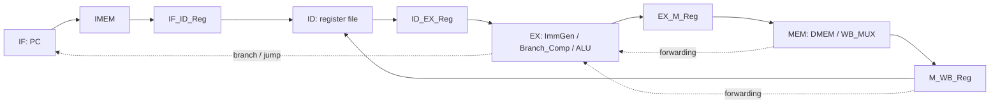

# 数据通路与模块

本说明对应 PPT 截图恢复版本，顶层连接用于阅读设计意图，目前不具备完整运行条件。

## 模块职责

| 文件 / 模块 | 职责 | 关键限制 |
| --- | --- | --- |
| `Top_module` | 连接流水级、控制器和转发选择器 | 缺失 `WBReg_ID_Hazard`，IMEM 端口数不一致 |
| `Control_logic` | 按各级指令生成 ALU、选择器、寄存器写回和访存控制 | 转发条件没有排除 rd=x0 |
| `Control_Hazard` | 在 EX 判断分支／跳转并清空前两级 | 没有 stall 接口 |
| `IF` | 异步高电平复位的 PC 寄存器 | PC 初值为 0 |
| `IMEM` | 256×32 位指令数组，读取 `program.txt` | 索引仅用 pc[9:2]，容量之外地址会截断 |
| `Reg` | 32×32 位寄存器文件，x0 读取为零 | 不是顶层引用的旁路寄存器模块；存在文件写出副作用 |
| `Branch_Comp` | 相等、有符号及无符号大小比较 | 通过 BrUn 选择比较方式 |
| `ImmGen` | I/S/B/U/J 立即数生成与符号扩展 | 默认输出零 |
| `ALU` | 加减、位运算、移位、比较及 LUI 数据选择 | 移位量取 B[4:0] |
| `DMEM` | 4096×32 位数据数组及部分宽度读写 | 字节偏移、窄写和文件输出存在已知限制 |
| `IF_ID_Reg` / `ID_EX_Reg` | 取指到译码、译码到执行的级间寄存器 | 清空时写入零指令；ID_EX 操作数没有复位赋值 |
| `EX_M_Reg` / `M_WB_Reg` | 执行到访存、访存到写回的级间寄存器 | 使用时钟上升沿更新 |
| `MUX_2` / `MUX` / `WB_MUX` | 四选一、二选一、写回数据选择 | 名称保留原材料 |

## 转发与分支

控制器同时查看 ID、EX、M、WB 级指令，其中 ID 输入在可见逻辑中未使用。EX 的 ALU 操作数可来自本级寄存器值、立即数／PC、M 级写回值和 WB 级写回值；当 M、WB 同时匹配时，M 优先。分支比较器也有 M、WB 转发路径。Store 的写数据具有 WB→M 旁路。

M 级写回选择在 `WB_MUX` 中完成，随后由 `M_WB_Reg` 保存。当前 DMEM 为组合读取模型，因此不能将其直接等同于同步 FPGA Block RAM，也不能据“没有 stall”就断言所有 load-use 情形均已正确处理。

分支成立与 JAL/JALR 都在 EX 发出跳转及 IF/ID、ID/EX 清空。顶层 PC 选择器实际位于 EX 计算结果到 IF PC 的反馈路径；PPT 把该实例写在 WB 小标题下，不改变其连接含义。

## 仿真模型边界

`Reg` 与 `DMEM` 包含 `$readmemh`、`$fopen`、`$fdisplay`，是带调试文件操作的课程模型。本次保留这些操作以维持截图版本行为，并将仿真隔离到临时目录。未执行综合、布局布线、FPGA 下载或时序测量。
